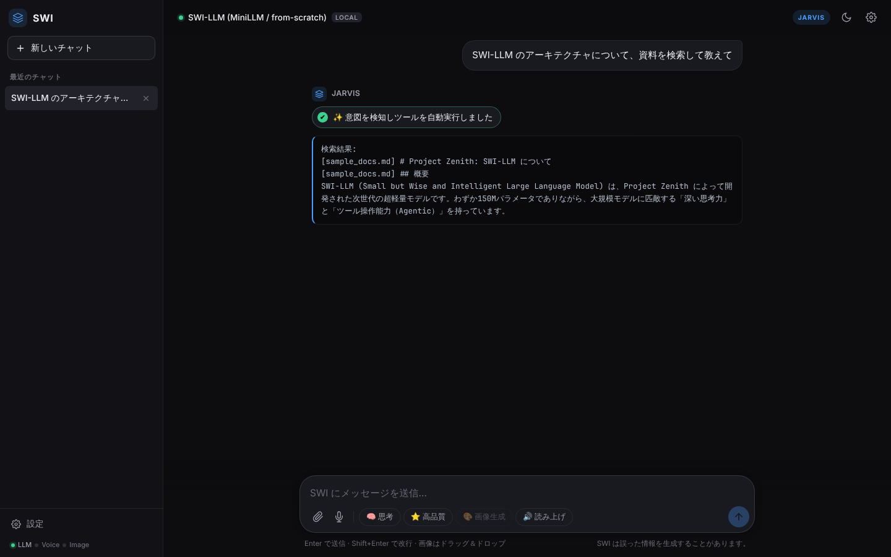
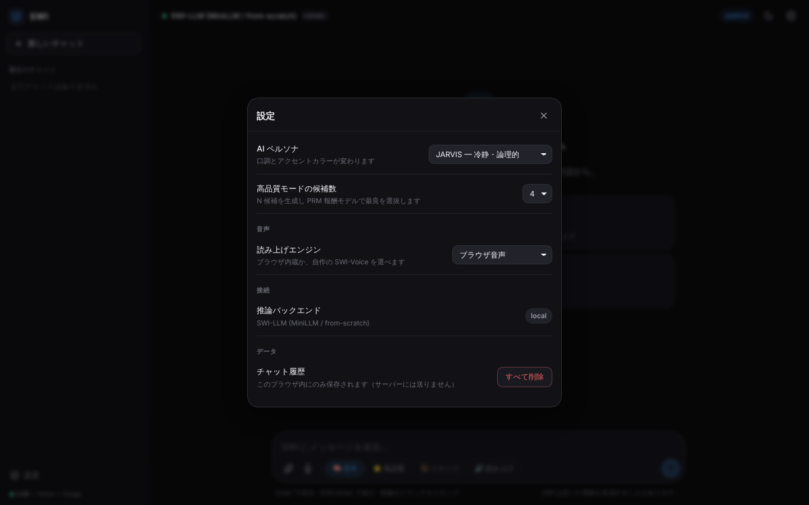

# SWING-LLM — 設計ドキュメント

> **LLM・音声合成・画像生成の 3 つの AI を、ゼロから自作した AI スイート。**
> モデルの部品・学習パイプライン・評価ゲート・Web 配信・安全機構までを、既製の LLM を使わずに PyTorch で実装し、1 台の PC（12GB の GPU）で学習から配信まで回せるようにした。

<table>
<tr>
<td width="50%"></td>
<td width="50%"></td>
</tr>
<tr>
<td align="center">ホーム（モード：思考・高品質・画像生成・読み上げ）</td>
<td align="center">意図を検知してツールを実行し、結果をそのまま表示</td>
</tr>
<tr>
<td width="50%"></td>
<td width="50%"></td>
</tr>
<tr>
<td align="center">文書検索（RAG）</td>
<td align="center">設定（ペルソナ・Best-of-N・読み上げ・声のクローン）</td>
</tr>
</table>

> スクリーンショットは学習前（ランダム重み）の状態で撮影しています。重みはリポジトリに含めていないため、モデルの文章生成は意味をなさず、ツールの結果が出た時点で生成を止めています。

## プロジェクト概要

| 項目 | 内容 |
|---|---|
| 種別 | AI スイート（自作の LLM・TTS・画像生成＋Web UI / API）／個人開発 |
| 利用環境 | Windows の PC（学習・配信。GPU は RTX 5070 12GB を想定、CPU でも動作）＋ブラウザ。テストは Linux でも実行 |
| 担当・進め方 | 企画・設計・モデル・学習・評価・Web・テストを 1 人で担当。実装とドキュメント作成には生成 AI（Claude Code）を活用し、仕様決め・設計の判断・レビュー・テストでの検証は自分で行った |
| 開発時期 | 2026 年 6 月〜10 月（コミットの記録: 6/23〜10/25） |
| 公開状況 | 未公開（手元で起動して試せる。学習済みの重みは含まない） |
| 規模 | Python 241 ファイル・約 29,600 行（LLM 約 10,600 ／ 音声 約 5,900 ／ 画像 約 1,800 ／ Web 約 1,600 ／ テスト 約 9,700）＋ Web UI 約 2,100 行＋ `run.ps1` 約 800 行 ／ ユニットテスト 762 件 |

### 技術スタック

| 分類 | 技術 |
|---|---|
| 言語 | Python 3.12、PowerShell、JavaScript / HTML / CSS |
| 機械学習 | PyTorch、SentencePiece、Hugging Face Datasets、SymPy（検証器）、scikit-learn |
| モデル | Multi-Head Latent Attention・Sparse MoE・MTP・PRM（LLM）、ViT（画像理解）、RVQ コーデック・AR コーデック LM・Flow Matching（音声）、VAE・DiT・Rectified Flow（画像） |
| 学習 | 事前学習・SFT・DPO・GRPO（DAPO）・RFT・PRM・LoRA、トークン予算コーパス |
| 配信 | FastAPI、uvicorn、WebSocket、Pydantic |
| 検索 | FAISS、BM25（自作）、RRF、Self-RAG |
| 音声の周辺 | torchaudio、soundfile、Silero VAD、faster-whisper |
| 品質 | unittest、ruff、mypy、GitHub Actions |

---

## このプロジェクトで伝えたいこと

### 1. LLM を部品から自作した

既製のモデルや学習済みの重みを使わず、**モデルの部品を一つずつ実装**しました（→ [設計書 2 章](design.md#2-自作-llmモデルと生成)）。

- **Multi-Head Latent Attention**：K・V を 512 次元の潜在に圧縮し、推論時は INT8 で KV キャッシュに持つ
- **Sparse MoE**：8 エキスパートの top-2。総パラメータ約 4.2 億のうち、1 トークンで動くのは約 1.95 億
- **MTP**（2・3 トークン先の予測）を使った**自己投機的デコード**、**PRM** ヘッドによる Best-of-N
- 自作 ViT による画像理解、日本語向けに自前で学習した SentencePiece（語彙 32,768）
- 思考（`<think>`）、ツール呼び出し（`<tool_call>`）、JSON として正しい形に制約する生成

### 2. 学習パイプラインを「止まっても壊れない」ように作った

1 台の PC で数日かかる学習を回す前提で、**失敗しても学習を失わない仕組み**を先に作りました（→ [設計書 7 章](design.md#7-運用設計学習パイプライン評価ゲートチェックポイント)）。

- チェックポイントはアトミックに保存し、30 分ごとにも保存。**読めないチェックポイントでは止まり、黙ってゼロから学習し直さない**
- 数十億トークンのコーパスはストリーミングで作り、**中断しても続きから、止めなかった場合とバイト単位で同じものができる**（メモリは 3,000 万トークンでも約 36MB）
- `run.bat` 1 つで、データ整備 → 事前学習 → SFT → 画像理解 → DPO → GRPO → 評価 → E2E を、規模（TEST〜MAX）を変えて回せる

### 3. まだ弱いモデルでも、使える形にした

学習量が足りないうちは、モデル自身のツール呼び出しはうまくいきません。そこで、

- **ルールベースで意図を先回りしてツールを実行し、その結果を利用者に直接見せる**（モデルの回答に埋もれさせない）
- 壊れた `<tool_call>` は制約デコードで作り直す
- RAG は BM25 と密検索を RRF で融合し、根拠が足りなければ「断定しない」よう指示する（Self-RAG）
- faiss・埋め込み・VAD・Docker が無い環境でも、WARNING を出したうえで代わりの方式で動き続ける

### 4. 安全を最初から組み込んだ

声や画像を生成できる AI なので、**悪用を防ぐ仕組みを機能と同時に**作りました（→ [設計書 4 章](design.md#4-音声-ai)・[6 章](design.md#6-web-api-とセキュリティ)）。

- 声のクローンは**話者ごとの明示同意が必須**。参照音声を復号する前に確認し、拒否を黙ってクローンなしに切り替えない
- すべての音声出力に、聞こえないレベルの電子透かしを入れる
- モデルからの Python 実行は既定で無効。有効にしても Docker か AST のホワイトリスト検査で囲む
- Host / Origin / トークンの検証、レート制限、公開の設定ミスで起動しない fail-closed、`weights_only=True` での読み込み

### 5. 測れる状態を先に作り、弱点も数字で残した

「投資効果を測れない状態で大規模な学習を始めない」を方針にし、**評価ゲート**（RAG recall@2・パープレキシティ・能力ベンチ・Function Calling・PSNR・SNR）を学習パイプラインに組み込みました。能力ベンチ 0 / 24、音声コーデックの SNR -1.21dB のように、**まだ足りない部分も実測値で記録**しています。ユニットテストは 762 件で、静的解析と合わせて GitHub Actions で実行しています（→ [テスト仕様・結果](test-report.md)）。

---

## 技術的な課題と解決

| 課題 | 解決 |
|---|---|
| 12GB の GPU に収まるモデルで、表現力を確保したい | MoE で総パラメータを増やしつつ 1 トークンの計算量を抑え、MLA の潜在 KV（INT8）で推論時のメモリを減らす |
| 数日かかる学習が、停電や強制終了で失われる | 一時ファイルに書いてから置き換えるアトミック保存、時間での定期保存、読めないチェックポイントでの停止 |
| 学習データを足したのに、学習が「完了済み」でスキップされた（実際に起きた） | 学習に使った件数をチェックポイントに保存し、件数が変わっていたら WARNING |
| 数十億トークンのコーパスはメモリに載らず、作るのにも時間がかかる | ストリーミングで書き出し、進み具合をアトミックに保存。再開時は記録位置まで切り詰めて、各ソースを消費済みの件数だけ読み飛ばす |
| 未学習のモデルはツール呼び出しの JSON を壊す | 制約デコードで修復し、ルールベースの先回りと結果の直接表示で補う |
| CI やオフラインでは、faiss・埋め込み・Docker などが無い | 足りない部品ごとに縮退先を用意し、WARNING で必ず知らせる（黙って品質を落とさない） |
| 利用者の切断後も、生成スレッドが動き続けてプールを占有する | `stop_event` で生成ループに停止を伝える |
| Windows で、日本語を含むパスへの FAISS の索引保存が失敗し、cp932 のコンソールでは一部の文字を含む警告ログが黙って消える | 索引をバイト列にして Python 側で保存し、コンソール出力を UTF-8 にそろえる |

---

## ドキュメント一覧

| ドキュメント | 内容 |
|---|---|
| [企画・要件定義書](requirements.md) | 背景・コンセプト・対象ユーザー・機能要件・非機能要件・範囲外 |
| [画面定義書](screen-definitions.md) | Web UI の画面一覧、各画面の表示項目／操作／業務ルール |
| [設計書](design.md) | システム構成・LLM・エージェントと RAG・音声・画像・Web API とセキュリティ・運用（パイプライン・評価ゲート・チェックポイント）・既知の課題 |
| [API 仕様書](api.md) | HTTP / WebSocket の全エンドポイント、境界防御、入力の上限、環境変数 |
| [テスト仕様・結果](test-report.md) | テスト方針・762 件の内訳と実行結果・代表ケース・静的解析・評価ゲート |
| [diagrams/](diagrams/) | PlantUML ソース（`src/`）と SVG（`svg/`） |
| [screenshots/](screenshots/) | Web UI のスクリーンショット |

### 図の一覧

| 図 | PlantUML | SVG |
|---|---|---|
| ユースケース図 | [usecase.puml](diagrams/src/usecase.puml) | [usecase.svg](diagrams/svg/usecase.svg) |
| システム構成図 | [architecture.puml](diagrams/src/architecture.puml) | [architecture.svg](diagrams/svg/architecture.svg) |
| クラス図① 自作 LLM | [class-llm.puml](diagrams/src/class-llm.puml) | [class-llm.svg](diagrams/svg/class-llm.svg) |
| クラス図② エージェントと RAG | [class-agent.puml](diagrams/src/class-agent.puml) | [class-agent.svg](diagrams/svg/class-agent.svg) |
| クラス図③ 音声・画像の配信と安全機構 | [class-serving.puml](diagrams/src/class-serving.puml) | [class-serving.svg](diagrams/svg/class-serving.svg) |
| シーケンス図① 会話とツール呼び出し | [seq-chat.puml](diagrams/src/seq-chat.puml) | [seq-chat.svg](diagrams/svg/seq-chat.svg) |
| シーケンス図② 読み上げと声のクローン | [seq-tts-clone.puml](diagrams/src/seq-tts-clone.puml) | [seq-tts-clone.svg](diagrams/svg/seq-tts-clone.svg) |
| シーケンス図③ 学習の再開と保存 | [seq-checkpoint.puml](diagrams/src/seq-checkpoint.puml) | [seq-checkpoint.svg](diagrams/svg/seq-checkpoint.svg) |
| アクティビティ図 学習パイプラインと評価ゲート | [activity-pipeline.puml](diagrams/src/activity-pipeline.puml) | [activity-pipeline.svg](diagrams/svg/activity-pipeline.svg) |
| 画面遷移図 | [screen-transition.puml](diagrams/src/screen-transition.puml) | [screen-transition.svg](diagrams/svg/screen-transition.svg) |

SVG の再生成：

```bash
cd Doc/diagrams/src
java -jar plantuml.jar -charset UTF-8 -tsvg -o ../svg *.puml
```
