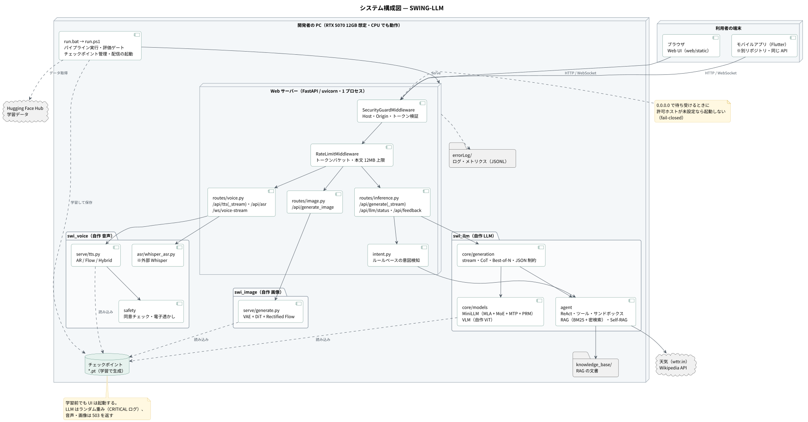
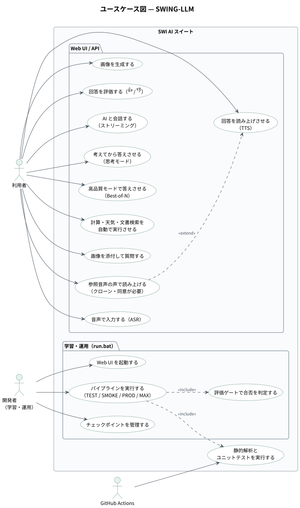
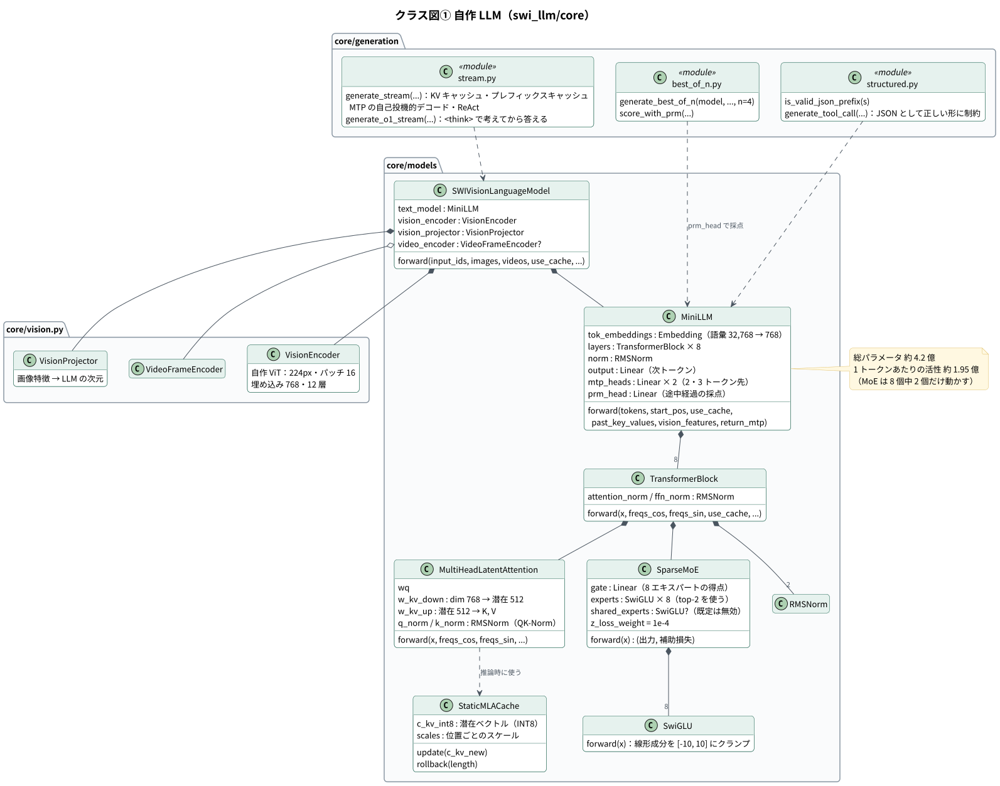
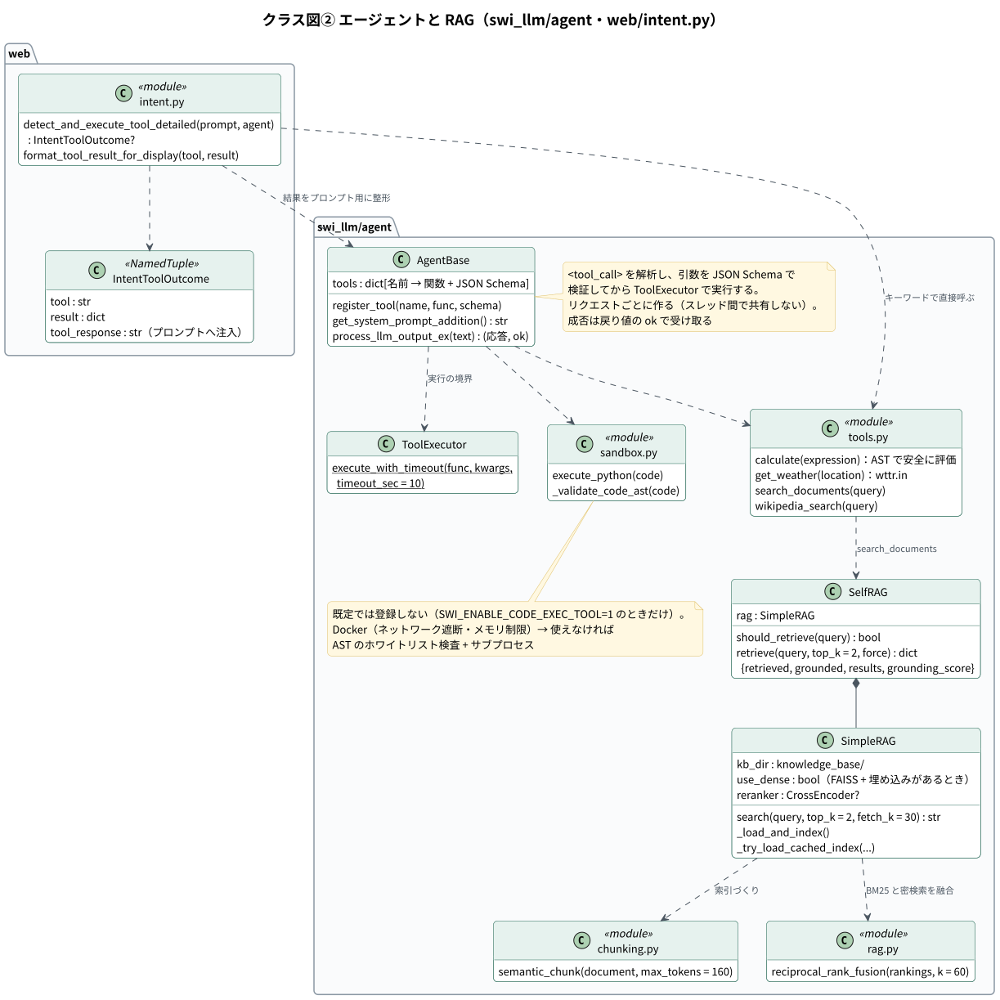
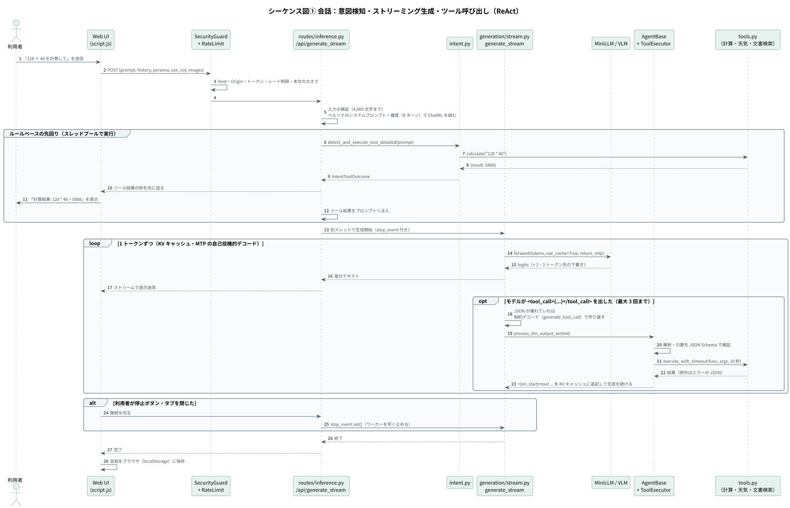
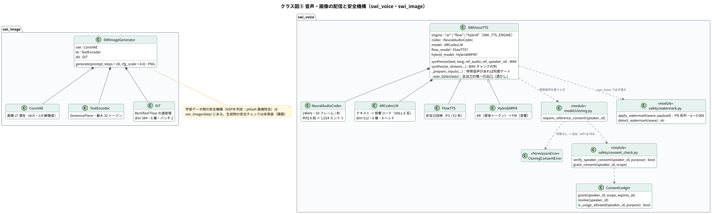
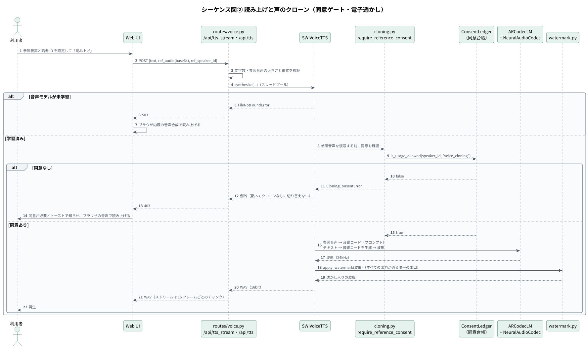
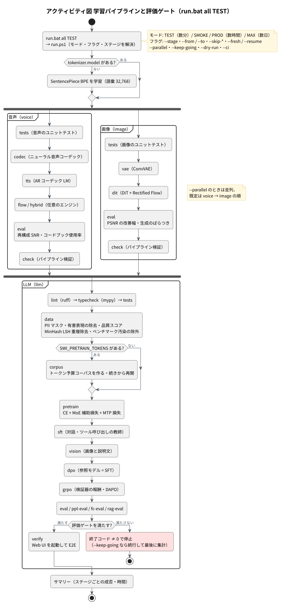
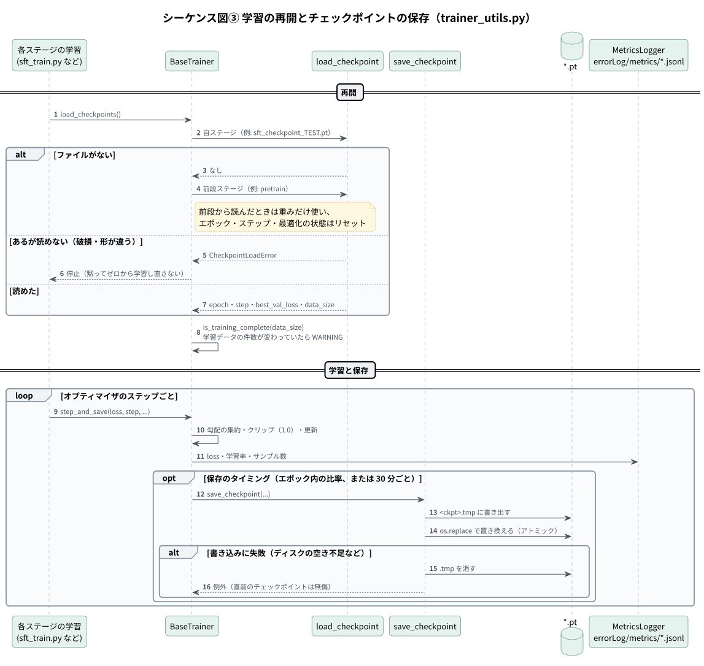

# 設計書 — SWING-LLM

1. [システム構成](#1-システム構成)
2. [自作 LLM（モデルと生成）](#2-自作-llmモデルと生成)
3. [エージェントと RAG](#3-エージェントと-rag)
4. [音声 AI](#4-音声-ai)
5. [画像生成 AI](#5-画像生成-ai)
6. [Web API とセキュリティ](#6-web-api-とセキュリティ)
7. [運用設計（学習パイプライン・評価ゲート・チェックポイント）](#7-運用設計学習パイプライン評価ゲートチェックポイント)
8. [ディレクトリ構成](#8-ディレクトリ構成)
9. [既知の課題と今後](#9-既知の課題と今後)

API の詳細は [API 仕様書](api.md) を参照してください。図の PlantUML ソースは [`diagrams/src/`](diagrams/src/)、SVG は [`diagrams/svg/`](diagrams/svg/) にあります。

---

## 1. システム構成



| 要素 | 技術 | 役割 |
|---|---|---|
| Web サーバー | FastAPI / uvicorn（1 プロセス） | Web UI の配信、HTTP / WebSocket API、境界防御、モデルの遅延ロード |
| LLM（`swi_llm`） | PyTorch・SentencePiece | 自作のモデル本体、生成、エージェント、RAG、学習、評価 |
| 音声（`swi_voice`） | PyTorch・torchaudio・soundfile | 音声コーデック、TTS 3 種、同意チェック、電子透かし、ASR・VAD の連携 |
| 画像（`swi_image`） | PyTorch | VAE・DiT・Rectified Flow、学習データの安全フィルタ |
| Web UI | 素の JavaScript・HTML・CSS | 会話、思考モード、画像の添付、読み上げ、画像生成、設定 |
| 実行 | `run.bat` → `run.ps1`（PowerShell） | 学習パイプライン、評価ゲート、チェックポイント管理、配信の起動 |
| 品質 | unittest・ruff・mypy・GitHub Actions | ユニットテスト 762 件、静的解析、CI |

### ユースケース



### 設計の要点

| 要点 | 内容 |
|---|---|
| 完全自作 | 答えを作る頭脳（LLM・TTS・画像生成）は自作する。外部の学習済みモデルは「学習データの安全フィルタ」「評価の物差し」と、ASR・VAD・RAG の埋め込みなどの周辺機能に限る |
| 1 台で完結 | 12GB の GPU 1 枚（RTX 5070 想定）で学習から配信まで回す。GPU が無ければ CPU で動く |
| 規模を設定で切り替える | `SWI_MODE` = TEST（数分）/ SMOKE / PROD（数時間）/ MAX（数日）。データ量・エポック・推論の上限・チェックポイント名の接尾辞が切り替わる |
| 学習前でも動く | モデルは初回に遅延ロード。重みが無いとき、LLM はランダム重みで動かし CRITICAL ログを出す。音声・画像は 503 を返し、UI はブラウザの音声合成に切り替える |
| 足りない部品があっても止めない | faiss・埋め込みが無ければ BM25 だけで検索、Silero VAD が無ければ RMS 方式、Docker が無ければ AST 検査のサンドボックスに切り替える（その旨を WARNING で出す） |

### 設定の仕組み

| 優先度 | 設定元 | 例 |
|---|---|---|
| 1 | 環境変数 | `SWI_MODE`・`SWI_PRETRAIN_TOKENS`・`SWI_TTS_ENGINE`・`SWI_API_TOKEN` |
| 2 | YAML（`configs/default.yaml` または `SWI_CONFIG`） | `model_arch`・`training`・`inference`・`vision`・`run` を深くマージ |
| 3 | Python の既定値 | `swi_llm/utils/config.py`・`constants.py` |

---

## 2. 自作 LLM（モデルと生成）



| 項目 | 値 |
|---|---|
| 次元 / 層 / ヘッド | 768 / 8 / 12 |
| 注意機構 | **Multi-Head Latent Attention**：K・V を 512 次元の潜在へ圧縮し、推論時は潜在を **INT8 に量子化**して KV キャッシュに持つ（`StaticMLACache`）。QK-Norm、RoPE（θ = 1e6、YaRN は実装済み・既定は無効） |
| FFN | **Sparse MoE**：エキスパート 8、top-2、SwiGLU（隠れ層 2048・線形成分を ±10 でクランプ）、z-loss 1e-4。共有エキスパートと補助損失なしの負荷分散も実装済み（既存チェックポイントとの互換のため既定は無効） |
| 追加ヘッド | **MTP** × 2（2・3 トークン先を予測し、自己投機的デコードに使う）、**PRM** × 1（途中経過の採点。Best-of-N で使う） |
| 規模 | 総パラメータ 約 4.2 億、1 トークンあたりの活性パラメータ 約 1.95 億 |
| 画像理解 | 自作 ViT（224px・パッチ 16・埋め込み 768・12 層）＋プロジェクタ。動画は任意のフレームエンコーダ |
| トークナイザ | SentencePiece BPE、語彙 32,768。日本語の 1 文字あたり約 0.55 トークン |
| 対話形式 | ChatML（`<\|im_start\|>system / user / assistant / tool`）。思考は `<think>…</think>`、ツール呼び出しは `<tool_call>{"name":…, "arguments":…}</tool_call>` |
| ペルソナ | `jarvis`（丁寧）と `navi`（くだけた口調）。学習と推論で同じシステムプロンプトを使う |

### 生成モード

| モード | 関数 | 主な仕組み |
|---|---|---|
| ストリーム | `generate_stream` | KV キャッシュ、プレフィックスキャッシュ（LRU 32 件）、MTP による自己投機的デコード、ReAct のツール実行、空応答の救済 |
| 思考（CoT） | `generate_o1_stream` | `<think>` で考えてから答える。難しい問いほど考える量を増やす |
| 高品質（Best-of-N） | `generate_best_of_n` | N 個の候補を作り、PRM ヘッドの点数が最も高いものを採用 |
| 構造化 | `generate_tool_call` | 壊れた `<tool_call>` を、JSON として正しい形になるよう制約して作り直す |

サンプリングの既定値は temperature 0.3・top-k 50・top-p 0.85・繰り返しペナルティ 1.15。生成位置が学習時の長さ（512）を超えると WARNING を出します。

---

## 3. エージェントと RAG



### 3-1. ツール実行の 2 系統

| 系統 | 場所 | 対象 | 結果の扱い |
|---|---|---|---|
| ルールベースの先回り | `web/intent.py`（生成の前） | 計算・天気・文書検索 | プロンプトへ注入し、**同時に利用者へ直接表示する**（モデルが弱いうちも、正しく実行できたツールの答えが埋もれない） |
| モデル自身の ReAct | `core/generation/stream.py` | 計算・天気・文書検索（＋許可したときだけ Python 実行） | `<tool_call>` を検出して実行し、結果を KV キャッシュに追記して生成を続ける。3 回続けて失敗したら通常の回答に切り替える |

- 実行の境界は `ToolExecutor.execute_with_timeout`（10 秒でタイムアウト、例外はエラーの JSON にする）。
- 成否は戻り値で受け取り、共有の属性は使わない（並行実行で取り違えないため）。
- `execute_python` は既定で登録しない。許可したときも Docker（ネットワーク遮断・メモリ / PID 制限）で動かし、Docker が無ければ AST のホワイトリスト検査（許可モジュール以外の import・危険な組み込み関数・`__class__` などの属性を拒否）＋サブプロセスで動かす。

### 3-2. 会話の流れ



### 3-3. RAG

| 段階 | 内容 |
|---|---|
| 索引 | `knowledge_base/` の `.txt` / `.md` を、見出しを優先して 160 トークン以内（重なり 24）に分割。索引は `.rag_cache/` に保存し、文書の内容が変わったら作り直す |
| 検索 | BM25（文字バイグラム）と密検索（FAISS の内積・正規化済み = コサイン）を **RRF（k = 60）** で融合し、一次候補 30 件をクロスエンコーダで並べ替えて上位 2 件 |
| 縮退 | faiss や埋め込みモデルが無ければ BM25 だけで動く。リランカが無ければ RRF の順のまま |
| Self-RAG | 取得した本文が問いを裏付けているかを採点し（しきい値 0.08）、足りなければ「断定しない」ようモデルに指示を返す |

---

## 4. 音声 AI



| 部品 | 内容 |
|---|---|
| ニューラル音声コーデック | 畳み込みのエンコーダ / デコーダ＋残差ベクトル量子化（RVQ 8 段 × 1,024）。24kHz・50 フレーム / 秒 |
| 意味 / 音響の分離 | 内容（意味トークン・12.5Hz）と声質（音響トークン）を分ける |
| TTS エンジン | `ar`（VALL-E 系の AR コーデック LM・既定）／ `flow`（F5 / E2 系の Flow Matching・非自己回帰）／ `hybrid`（AR で意味 → FM で音響）。指定のチェックポイントが無ければ `ar` に戻す |
| その他 | ボコーダ（GAN）、継続時間モデル、スタイル・感情の制御、ウェイクワード、割り込み、ツール実行中のつなぎ発話、品質ドリフトの監視（部品としてテストあり） |

### 安全機構

| 機構 | 内容 |
|---|---|
| 同意ファースト | 参照音声を使う合成（声のクローン）は話者 ID が必須。同意台帳に `voice_cloning` の明示同意が無ければ `CloningConsentError`（API は 403）。**参照音声を復号する前**に確認し、拒否を黙ってクローンなしの合成に切り替えない |
| 学習データの同意 | 公開ライセンスのコーパスはデータセット単位の同意として扱う（クローン用途は含めない）。未知の話者は既定で除外 |
| 電子透かし | すべての出力が通る唯一の出口（`_wav_bytes`）で、擬似ノイズ系列を聞こえないレベル（α = 0.006・約 -44dB）で加える。検出は相関で行う |
| 学習データの品質 | SNR のパーセンタイルで低品質なクリップを除く |



---

## 5. 画像生成 AI

| 部品 | 内容 |
|---|---|
| ConvVAE | 画像 ⇔ 潜在（4ch・1/8 解像度）。`scale_factor` をチェックポイントに保存し、読み込み時はその値を使う |
| 学習の補助 | 知覚的損失（ImageNet 学習済みの SqueezeNet / VGG16）と PatchGAN の敵対的損失 |
| TextEncoder | dim 256・2 層・4 ヘッド、最大 32 トークン（LLM と同じ SentencePiece） |
| DiT | dim 384・6 層・6 ヘッド・パッチ 2 |
| 学習と生成 | Rectified Flow（データとノイズの直線補間の速度を予測）。生成は Euler 28 ステップ、CFG 4.0（学習時に 10% の確率で条件を落とす） |
| 画像サイズ | TEST 32px / SMOKE 64px / PROD・MAX 128px |
| 学習データの安全 | NSFW 判定（外部の ViT 分類器・確率 0.85 以上を除外）、64bit pHash のハミング距離 6 以内を重複として除外、CSAM のハッシュ照合を差し込む口 |

---

## 6. Web API とセキュリティ

ミドルウェアは外側から **SecurityGuard → RateLimit → CORS → ルーター** の順に通ります。エンドポイントの入出力は [API 仕様書](api.md) にあります。

| 脅威 | 対策 |
|---|---|
| DNS リバインディング | Host を許可リストで常に検証 |
| 他サイトからの書き込み | 状態を変える HTTP と WebSocket で Origin を検証 |
| なりすまし | `SWI_API_TOKEN` を設定すると `/api/*`・`/ws/*` でトークン必須。定数時間で比較 |
| 公開の設定ミス | `0.0.0.0` で待ち受けるときに許可ホストが未設定なら起動しない（fail-closed） |
| 乱用・DoS | クラス別のトークンバケット（生成 60 / 分・画像 10 / 分・音声 60 / 分・その他 300 / 分）、本文 12MB、プロンプト 4,000 文字、履歴 16,000 文字・8 ターン、同時生成 2 本 |
| 任意コード実行 | `execute_python` は既定で無効。有効にしてもサンドボックスで実行（3-1） |
| 悪意ある重みファイル | 配信は `torch.load(weights_only=True)` |
| 個人情報 | 入力本文はログに残さず、長さ・件数だけを記録する |
| 声の悪用 | クローンは明示同意が必須、すべての出力に透かし（4 章） |
| 生成停止の取りこぼし | 接続が切れたら `stop_event` で生成スレッドを止め、スレッドプールを占有し続けない |

---

## 7. 運用設計（学習パイプライン・評価ゲート・チェックポイント）

`run.bat` は `run.ps1` を呼ぶだけの薄い入口で、処理はすべて `run.ps1` にまとめています。

| コマンド | 内容 |
|---|---|
| `run.bat` | メニュー（[1] = Web UI の起動） |
| `run.bat serve [MODE]` | Web UI を起動（http://127.0.0.1:5000） |
| `run.bat llm\|voice\|image\|all MODE` | 学習パイプライン（`all` は voice → image → llm） |
| `run.bat status / config / ckpt / logs` | チェックポイントの状態・実効設定・チェックポイントの一覧 / 削除 / 退避 / 復元・ログ |
| フラグ | `--stage`・`--from` / `--to`・`--skip-data / tests / e2e / train`・`--fresh` / `--resume`・`--parallel`・`--keep-going`・`--dry-run`・`--ci` |



### 評価ゲート

評価ステージは終了コードでパイプラインを止めます。しきい値は実測にもとづいて決め、品質がまだ低いものは「壊れたこと（NaN・形の不一致・完全な崩壊）を検知する」値にしています。

| 評価 | 指標 | ゲート | 記録上の実測値 |
|---|---|---|---|
| RAG | recall@2 | ≥ 0.8 | 100%（BM25 だけでも 100%） |
| パープレキシティ | held-out 文 | ≤ 20,000 | ランダム重み 約 38,900 / TEST 相当の事前学習 約 10,800 |
| 能力ベンチ | 正答率（24 問） | ≥ 0.0（クラッシュ検知） | 0 / 24 |
| Function Calling | dispatch_ok | ≥ 0.0（クラッシュ検知） | 0% |
| 画像 | PSNR の改善幅 / 生成のばらつき | ≥ -2.0dB / ≥ 0.02 | -0.45dB（目標 +1.0dB） |
| 音声 | コーデックの SNR / コードブック使用率 | ≥ -3.0dB / ≥ 0.002 | -1.21dB / 0.4%（目標 0dB / 30%） |

### 学習の堅牢性



| 項目 | 内容 |
|---|---|
| 保存 | `<ckpt>.tmp` に書いてから `os.replace` で置き換える（アトミック）。失敗したら例外にし、直前のチェックポイントは無傷 |
| 定期保存 | エポック内の比率に加えて 30 分ごと（`SWI_CKPT_SAVE_MINUTES`） |
| 再開 | 自ステージ → 前段ステージ → pretrain の順に探す。**存在するのに読めないチェックポイントでは止まる**（黙ってゼロから学習し直さない） |
| 完了判定 | 学習データの件数が前回と違うのに「完了」扱いになりそうなときは WARNING |
| メトリクス | `errorLog/metrics/<stage>_<MODE>.jsonl` に loss・学習率・GPU メモリ・スループット |
| トークン予算コーパス | `SWI_PRETRAIN_TOKENS`（例: `4B`）を指定すると、Web・Wikipedia・コード・書籍・arXiv・対話を比率どおりに混ぜて `train.bin` / `val.bin` を作る。末尾 15% は高品質ソースを 3 倍。書き出しのたびに進み具合を保存し、中断しても続きから作れる（中断しない場合とバイト単位で同じ結果）。メモリは 3,000 万トークンでも約 36MB |

### CI

GitHub Actions（`.github/workflows/ci.yml`）で、ruff・mypy・LLM / 音声 / 画像のユニットテストを実行します（CPU 版 torch）。データの取得を伴う学習と E2E は CI では回さず、手元の `run.bat` が担います。

---

## 8. ディレクトリ構成

```
prototype/
  swi_llm/
    core/models/       MiniLLM（MLA・MoE・MTP・PRM）・VLM
    core/generation/   ストリーム・思考・Best-of-N・JSON 制約・サンプラー
    agent/             AgentBase・ToolExecutor・ツール・サンドボックス・RAG・Self-RAG
    data/              トークナイザ・データ整備・トークン予算コーパス・SFT / DPO / GRPO のデータ・検証器
    training/          pretrain・SFT・vision・DPO・GRPO・RFT・PRM・LoRA・継続学習
    eval/              能力ベンチ・パープレキシティ・Function Calling・RAG・汚染チェック
    utils/             設定・定数・学習の共通処理・メトリクス・ログ
    knowledge_base/    RAG の文書（サンプル）
  swi_voice/           codec・model・serve・asr・duplex・safety・train・eval・agents
  swi_image/           model・train・serve・data・eval
  web/                 app.py・routes/・intent.py・models.py・rate_limit.py・static/
  tests/               unit/（ユニットテスト 80 ファイル）・pipeline_check・log_check・webui_test
  configs/default.yaml YAML による設定の上書き
  requirements.txt・pyproject.toml（ruff・mypy の設定）
run.bat・run.ps1        学習・評価・配信の実行
.github/workflows/ci.yml
Doc/                   設計資料（このフォルダ）
```

---

## 9. 既知の課題と今後

| 区分 | 内容 |
|---|---|
| モデルの品質 | 仕組みは一通り動くが、能力ベンチ・Function Calling はまだ 0%。製品水準の日本語対話には大規模な事前学習（トークン予算コーパスで数十億トークン）が必要 |
| 音声・画像の品質 | 音声コーデック・画像 VAE は単純な基準手法を下回る状態を数値で把握済み。自作のまま本学習と設計の見直しで改善する |
| ツール | `wikipedia_search` は実装・テスト済みだが、モデルの ReAct ループに登録されていないため会話からは呼ばれない。同期版 `/api/generate` ではツールが動かない |
| 公開運用 | TLS 終端（リバースプロキシ）、`/healthz`、プロセス管理、リクエスト単位のメトリクスが未対応 |
| 安全 | 音声透かしは切り貼り・再圧縮に弱く、埋め込みに失敗しても透かしなしで返す（fail-open）。生成画像の安全チェック・透かし・C2PA は未実装 |
| 環境 | cuDNN を全体で無効にしている（RTX 5070 での Conv2d のクラッシュ回避）。原因の切り分けが残っている |
