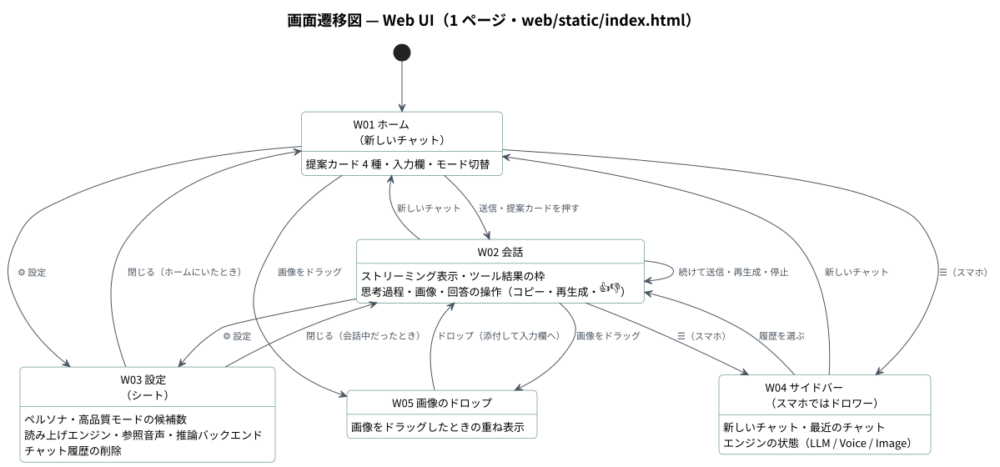
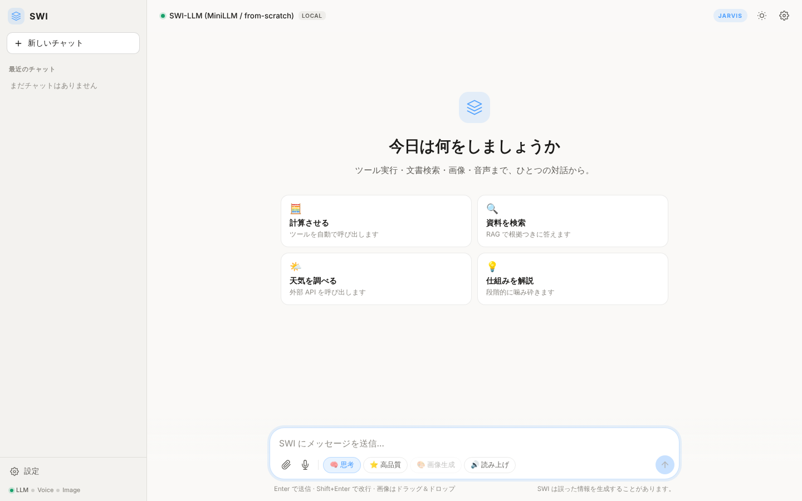
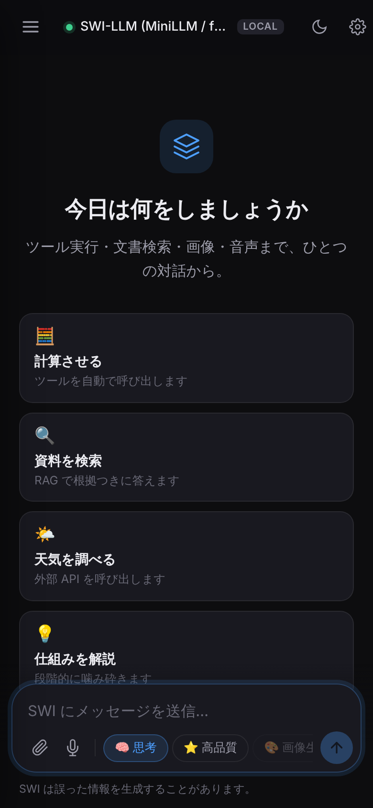

# 画面定義書 — SWING-LLM

| 項目 | 内容 |
|---|---|
| 対象 | Web UI（`prototype/web/static/`：`index.html`・`script.js`・`style.css`）。PC ブラウザとスマホのブラウザ |
| ページ | 1 ページ（`/`）。シングルページで 5 つの画面状態を切り替える |
| 画面遷移図 | [diagrams/svg/screen-transition.svg](diagrams/svg/screen-transition.svg) |
| 共通仕様 | ダーク / ライトのテーマ切り替え（端末の設定に追従・手動でも可）。幅が狭いとサイドバーはドロワーになる。会話・設定はブラウザ内（localStorage）だけに保存し、サーバーには送らない。起動時に `/api/llm/status`・`/api/voice/status`・`/api/image/status` を読み、**使えない機能のボタンは理由つきで無効にする** |
| スクリーンショット | 学習前（ランダム重み）の状態で撮影。ツールの実行結果は LLM の生成を待たずに表示されるため、結果が出た時点で生成を止めて撮影している |

---

## 1. 画面一覧

| ID | 画面名 | 実装 | 概要 |
|---|---|---|---|
| W01 | ホーム（新しいチャット） | `#hero`・`#suggest` | 挨拶と提案カード 4 種、入力欄 |
| W02 | 会話 | `#messages` | ストリーミング表示、ツール結果、思考過程、回答の操作 |
| W03 | 設定（シート） | `#settings-sheet` | ペルソナ・高品質モード・読み上げ・参照音声・接続先・履歴の削除 |
| W04 | サイドバー（スマホではドロワー） | `#sidebar` | 新しいチャット・最近のチャット・エンジンの状態 |
| W05 | 画像のドロップ | `#drop-overlay` | 画像をドラッグしたときの重ね表示 |

---

## 2. 画面詳細

### W01 ホーム（新しいチャット）

<table>
<tr>
<td width="50%"></td>
<td width="50%"></td>
</tr>
<tr>
<td align="center">ダークテーマ</td>
<td align="center">ライトテーマ</td>
</tr>
</table>

| No | 項目 | 種別 | 内容 |
|---|---|---|---|
| 1 | モデル表示 | チップ | 稼働中の推論バックエンド（「SWI-LLM (MiniLLM / from-scratch)」・LOCAL） |
| 2 | ペルソナ表示 | ラベル | JARVIS / NAVI。ペルソナでアクセントカラーが変わる |
| 3 | テーマ切替・設定 | ボタン | テーマの切り替え、W03 を開く |
| 4 | 提案カード | ボタン | 「計算させる」「資料を検索」「天気を調べる」「仕組みを解説」。押すとその文で送信して W02 へ |
| 5 | 入力欄 | テキスト | 最大 4,000 文字（3,000 文字を超えると文字数を表示）。Enter で送信、Shift+Enter で改行 |
| 6 | 画像を添付 | ボタン | 画像を選ぶ。画像理解が使えないときは無効 |
| 7 | 音声で入力 | ボタン | ブラウザの音声認識で入力。非対応のブラウザでは表示しない |
| 8 | モード | トグル | 🧠 思考・⭐ 高品質・🎨 画像生成・🔊 読み上げ。次の送信の振る舞いを変える。高品質と画像生成は同時に選べない。画像モデルが未学習なら 🎨 は無効 |
| 9 | 送信 / 停止 | ボタン | 入力が空なら無効。生成中は停止ボタンに変わる |

---

### W02 会話

<table>
<tr>
<td width="50%"></td>
<td width="50%"></td>
</tr>
<tr>
<td align="center">計算ツールの自動実行（128 × 46 = 5888）</td>
<td align="center">文書検索（RAG）の結果をそのまま表示</td>
</tr>
</table>

| No | 項目 | 種別 | 内容 |
|---|---|---|---|
| 1 | 利用者の発話 | テキスト | 添付した画像はサムネイルで表示 |
| 2 | ツール実行の通知 | ラベル | 「✨ 意図を検知しツールを自動実行しました」 |
| 3 | ツール結果 | 枠 | 計算結果・天気・検索結果を、LLM の生成を待たずに表示（HTML としてではなく文字として描画） |
| 4 | 思考プロセス | 折りたたみ | 思考モードのとき、`<think>` の中身を「思考プロセス」として表示 |
| 5 | 回答 | テキスト | Markdown・数式（KaTeX）・コードのハイライトを表示。HTML は DOMPurify で無害化 |
| 6 | 根拠バッジ | ラベル | RAG の根拠があるかを「🔍 根拠あり」「⚠️ 根拠不十分」で表示 |
| 7 | 生成画像 | 画像 | 画像生成モードの結果（PNG） |
| 8 | 回答の操作 | ボタン | コピー・再生成・👍・👎（👍 / 👎 は `/api/feedback` へ送り、押したら無効） |
| 9 | 最新へ | ボタン | 上にスクロールしたときだけ表示 |

| 業務ルール | 内容 |
|---|---|
| ストリーミング | `/api/generate_stream` の応答を逐次描画。高品質モードは `/api/generate`（非ストリーム） |
| 停止 | 停止を押すと通信を切り、サーバー側の生成スレッドも止まる |
| 読み上げ | 読み上げモードのとき、回答を SWI-Voice（ストリーム → 一括の順に試す）で読み上げ、使えなければブラウザの音声で読み上げる |
| エラー | 画像モデルが未学習（503）などは、理由をトーストで表示 |

---

### W03 設定（シート）

| No | 項目 | 種別 | 内容 |
|---|---|---|---|
| 1 | AI ペルソナ | 選択 | JARVIS — 冷静・論理的 ／ NAVI — 明るく親しみやすい |
| 2 | 高品質モードの候補数 | 選択 | 2 / 4（既定） / 8。Best-of-N が使えないときは非表示 |
| 3 | 読み上げエンジン | 選択 | ブラウザ音声 ／ SWI-Voice。音声モデルが未学習なら「SWI-Voice（未学習）」として選べない |
| 4 | 参照音声 | ファイル・テキスト | SWI-Voice を選んだときだけ表示。音声ファイルと話者 ID を指定。同意のない話者は 403 で拒否され、トーストで知らせる |
| 5 | 推論バックエンド | 表示 | `/api/llm/status` の結果（local / モデル名） |
| 6 | チャット履歴 | ボタン | すべて削除（ブラウザ内の履歴だけ） |

---

### W04 サイドバー（スマホではドロワー）

| No | 項目 | 種別 | 内容 |
|---|---|---|---|
| 1 | 新しいチャット | ボタン | W01 へ |
| 2 | 最近のチャット | リスト | 会話のタイトル（最初の発話）。押すとその会話を W02 に表示。× で削除 |
| 3 | 設定 | ボタン | W03 を開く |
| 4 | エンジンの状態 | 表示 | LLM / Voice / Image が使えるかを点で表示 |

スマホでは ☰ で開き、背景を押すと閉じます（上の画像はスマホ幅でのホーム）。

---

### W05 画像のドロップ

| No | 項目 | 種別 | 内容 |
|---|---|---|---|
| 1 | 重ね表示 | オーバーレイ | 画像を画面にドラッグしている間だけ表示 |
| 2 | ドロップ | 操作 | 画像を添付して入力欄のサムネイルに追加（画像理解が使えないときは受け付けない） |
