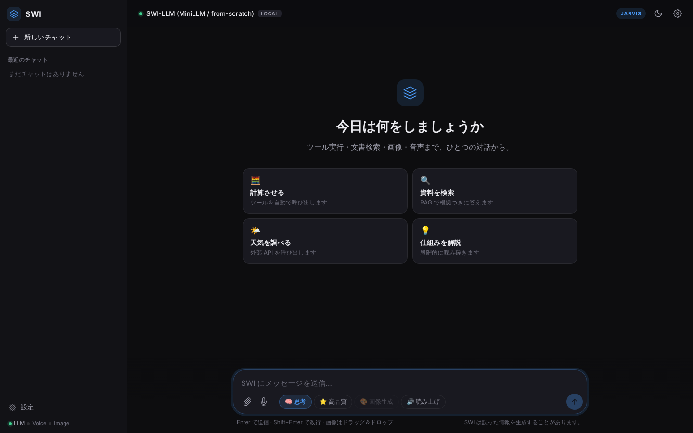
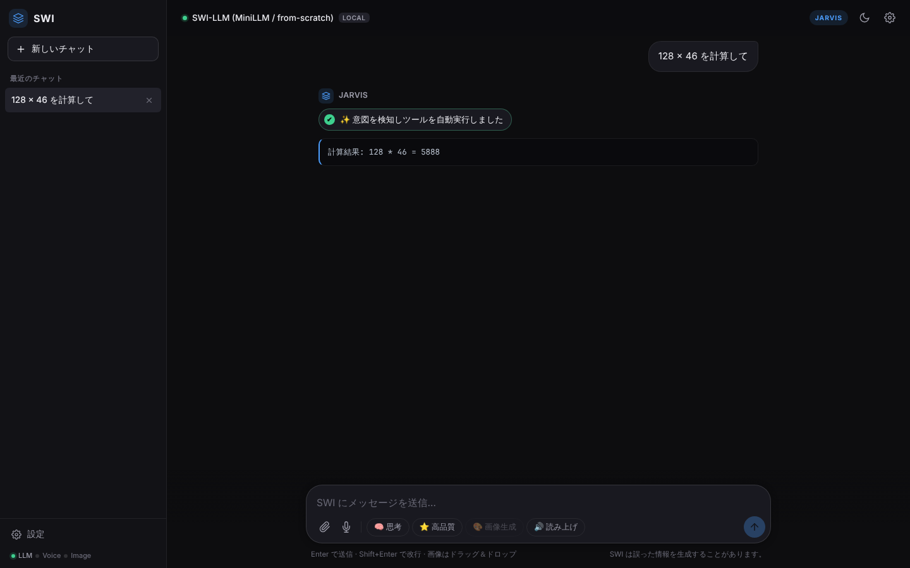

# SWING-LLM — 完全自作の AI スイート（LLM・音声・画像）

[](https://github.com/sawai-naoki-portfolio/SWING-LLM/actions/workflows/ci.yml)

> **ポートフォリオ作品**（[作品一覧へ](https://github.com/sawai-naoki-portfolio)）。設計資料（要件定義書・画面定義書・設計書・API 仕様書・テスト結果・UML 図）は [`Doc/`](Doc/README.md) にあります。
>
> | 項目 | 内容 |
> |---|---|
> | 開発 | 個人開発。企画・仕様決め・設計の判断・レビュー・テストでの検証は自分で行い、実装とドキュメント作成には生成 AI（Claude Code）を活用 |
> | 開発時期 | 2026 年 6 月〜10 月（コミットの記録: 6/23〜10/25） |
> | 公開状況 | 未公開（手元で起動して試せる。学習済みの重みは含まない） |

LLM（文章）・音声合成・画像生成の 3 つの AI を**ゼロから自作**し、1 台の PC（12GB の GPU）で学習から配信まで完結させるプロジェクトです。既製の LLM は使わず、モデルの部品・学習パイプライン・評価ゲート・Web 配信・安全機構までを PyTorch と FastAPI で実装しています。

<table>
<tr>
<td width="50%"></td>
<td width="50%"></td>
</tr>
<tr>
<td align="center">ホーム</td>
<td align="center">意図を検知してツールを実行し、結果をそのまま表示</td>
</tr>
</table>

> スクリーンショットは学習前（ランダム重み）の状態です。重みは含めていないため、モデルの文章生成は意味をなさず、ツールの結果が出た時点で生成を止めて撮影しています。

| AI | 自作したもの |
|---|---|
| **LLM**（`swi_llm`） | Multi-Head Latent Attention（INT8 の潜在 KV キャッシュ）＋ Sparse MoE（8 エキスパート・top-2）＋ MTP（自己投機的デコード）＋ PRM（Best-of-N）。総パラメータ約 4.2 億・活性約 1.95 億。自作 ViT による画像理解、SentencePiece（語彙 32,768）、思考モード、ReAct のツール呼び出し、ハイブリッド RAG と Self-RAG |
| **音声**（`swi_voice`） | 24kHz のニューラル音声コーデック（RVQ 8 段）、TTS 3 種（AR コーデック LM / Flow Matching / ハイブリッド）、ストリーミング合成。**声のクローンは話者ごとの明示同意が必須**、すべての出力に電子透かし |
| **画像**（`swi_image`） | ConvVAE ＋ DiT ＋ Rectified Flow（CFG）。学習データの NSFW 判定と pHash 重複除去 |
| **学習・評価** | データ整備 → 事前学習 → SFT → 画像理解 → DPO → GRPO（DAPO）→ 評価ゲート → E2E を `run.bat` 1 つで実行。アトミックな保存と再開、中断できるトークン予算コーパス |
| **Web** | FastAPI ＋ WebSocket と、素の JavaScript の Web UI。Host / Origin / トークン検証、レート制限、公開の設定ミスで起動しない fail-closed |

> **設計ドキュメント** — 企画・要件定義書・画面定義書・設計書（構成図／クラス図／シーケンス図／アクティビティ図／画面遷移図）・API 仕様書・テスト仕様は
> [`Doc/`](Doc/README.md) にまとめています。

## 動作環境

| 項目 | 内容 |
|---|---|
| OS | 学習・配信は Windows 10 / 11（`run.bat` → PowerShell 5.1 以上）。ユニットテストは Linux / macOS でも実行可 |
| Python | 3.12 |
| GPU | 任意（RTX 5070 12GB を想定。無ければ CPU で動作） |
| ネットワーク | 学習データの取得に Hugging Face Hub へ接続（TEST モードでも必要） |
| Docker | 任意（モデルからの Python 実行を許可するときのサンドボックス） |

## セットアップ

```bat
cd prototype
python -m venv .venv
.venv\Scripts\activate
pip install torch torchvision torchaudio   :: GPU を使うときは PyTorch 公式の手順で CUDA 版を入れる
pip install -r requirements.txt
```

## 使い方

プロジェクトのルートで実行します。

```bat
run.bat                 :: メニュー（[1] = Web UI の起動）
run.bat serve           :: Web UI を起動 → http://127.0.0.1:5000
run.bat all TEST        :: 音声 → 画像 → LLM のパイプラインを TEST モード（数分）で実行
run.bat llm SMOKE       :: LLM だけを SMOKE モードで実行（PROD = 数時間、MAX = 数日）
run.bat llm TEST --from dpo --to grpo   :: ステージの範囲を指定
run.bat status          :: チェックポイントと前提条件の確認
run.bat --help          :: サブコマンド・フラグ・環境変数の一覧
```

学習前に `serve` すると、LLM はランダム重みで動き（意味のある文章は出ません）、音声・画像は「未学習」として無効になります。ツールの自動実行（計算・天気・文書検索）は学習前でも動きます。

| 主な環境変数 | 意味 |
|---|---|
| `SWI_MODE` | TEST / SMOKE / PROD / MAX（`run.bat` が設定） |
| `SWI_PRETRAIN_TOKENS` | 事前学習のトークン数の予算（例: `4B`）。指定するとトークン予算コーパスを作って 1 パスで学習 |
| `SWI_TTS_ENGINE` | `ar`（既定）/ `flow` / `hybrid` |
| `SWI_API_TOKEN` | 設定すると `/api/*`・`/ws/*` でトークン認証が必須 |
| `SWI_WEB_HOST` / `SWI_WEB_PORT` | 待ち受け（既定 `127.0.0.1:5000`）。外部に公開するときは `SWI_ALLOWED_HOSTS` も必須 |

## フォルダ構成

```
prototype/
├── swi_llm/            自作 LLM
│   ├── core/           モデル（MiniLLM・VLM）と生成（ストリーム・思考・Best-of-N・JSON 制約）
│   ├── agent/          ツール呼び出し・サンドボックス・RAG・Self-RAG
│   ├── data/           トークナイザ・データ整備・トークン予算コーパス・各ステージのデータ・検証器
│   ├── training/       pretrain・SFT・vision・DPO・GRPO・RFT・PRM・LoRA・継続学習
│   ├── eval/           能力ベンチ・パープレキシティ・Function Calling・RAG
│   ├── utils/          設定・定数・学習の共通処理・メトリクス・ログ
│   └── knowledge_base/ RAG の文書（サンプル）
├── swi_voice/          自作 音声（コーデック・TTS・ASR・全二重・安全機構・学習・評価）
├── swi_image/          自作 画像（VAE・DiT・学習・配信・安全フィルタ・評価）
├── web/                FastAPI（app.py・routes/・intent.py・rate_limit.py）と Web UI（static/）
├── tests/              ユニットテスト（unit/）・パイプライン検証・Web UI の E2E
├── configs/            YAML による設定の上書き
├── requirements.txt
└── pyproject.toml      ruff・mypy の設定
run.bat / run.ps1       学習・評価・配信のオーケストレータ
Doc/                    設計資料
```

## 設計

詳しくは [設計書](Doc/design.md) にあります。要点だけ挙げます。

- **完全自作**：答えを作る頭脳は自作し、外部の学習済みモデルは「学習データの安全フィルタ」「評価の物差し」と、ASR・VAD・RAG の埋め込みなどの周辺機能に限る
- **規模を設定で切り替える**：同じコードを TEST（数分）から MAX（数日）まで、`SWI_MODE` で切り替えて回す
- **止まっても壊れない学習**：アトミックな保存、30 分ごとの保存、読めないチェックポイントでは止まる、データ変更の検知
- **弱いモデルでも使える**：ルールベースの先回りでツールを実行して結果を直接表示、壊れた JSON は制約デコードで修復
- **足りない部品で止めない**：faiss・埋め込み・VAD・Docker が無ければ、WARNING を出して代わりの方式で動く
- **測ってから投資する**：評価ゲートを学習パイプラインに組み込み、弱点も実測値で記録する

## テスト

```bash
cd prototype
python -m ruff check .
python -m mypy
SWI_MODE=TEST python -m tests.run_unit_tests         # すべてのユニットテスト
SWI_MODE=TEST python -m tests.run_voice_unit_tests   # 音声だけ
```

ユニットテストは 80 ファイル・762 件で、2026-10-25 の実行で失敗 0（学習済みの重みや外部 API が必要な 7 件はスキップ）。プッシュごとに GitHub Actions でも実行します。内訳は [テスト仕様・結果](Doc/test-report.md) にあります。

## 公開版について

非公開の開発リポジトリから、作品を理解・評価するのに必要なものだけを移しています。開発の履歴（コミット）は元のリポジトリにあり、ここには含めていません。

| 移していないもの | 理由 |
|---|---|
| 学習済みの重み（`*.pt`） | 学習で生成するため |
| arXiv 論文の本文テキスト（約 3,350 件）・整形済みの Wikipedia コーパス | 第三者の著作物のため。無くても残りのデータで学習でき、Wikipedia はパイプラインが取得し直す |
| RAG の索引キャッシュ | 初回の検索で作り直されるため |
| 実在の企業名を使った RAG テスト用の架空文書 | 誤解を避けるため、完全に架空の文書に差し替えた |
| AI アシスタント向けの作業メモ・設計の下書き・コードレビューの記録 | 作品そのものではないため。要点は `Doc/` にまとめ直した |
| ローカル環境の設定・作業用スクリプト | 個人の環境に依存するため |

モバイルアプリ（Flutter）は別のリポジトリで開発しており、この作品には含めていません（同じ API を使います）。
